# Urban Threads: Shopify Fashion Store

A fully working Shopify store for the fictional fashion label **URBAN THREADS**, built as the Ace360degree intern assignment.

- **Live preview:** https://urban-threads-699dwfml.myshopify.com (a password-protected development store; the password is shared separately and is not stored in this repository)
- **Theme:** Dawn, Shopify's free Online Store 2.0 theme (published)
- **Currency:** Indian rupee, displayed as `₹1,499`

## Setup

1. Create a Shopify development store and keep the default Dawn theme.
2. **Products:** go to Products → Import. Upload `urban_threads_products.csv` (the 8 assigned products), then `urban_threads_new_products.csv` (4 additional products).
3. **Collections:** create five smart (automated) collections so that new products join them automatically.
   - Men: product tag is `Men`
   - Women: product tag is `Women`
   - T-Shirts: product type is `T-Shirts`
   - Jeans: product type is `Jeans`
   - Shirts: product type is `Shirts`
4. **Pages:** create About Us, Contact Us, Shipping Policy and Return Policy under Online Store → Pages.
5. **Theme:** open Online Store → Themes → Customize. Pages were customised with Dawn's built-in `Custom Liquid` sections (HTML, CSS and JavaScript) and theme settings for logo, colours, typography and navigation.
6. **Preview:** open the store URL, enter the store password and follow the test flow below.

## Products and variants

| Product | SKU | Price | Collections | Options |
|---|---|---|---|---|
| Men's Classic Cotton T-Shirt | MTS001 | ₹699 | Men, T-Shirts | Black / White / Navy × S–XXL |
| Men's Oversized T-Shirt | MTS002 | ₹899 | Men, T-Shirts | Beige / Black / Olive × S–XL |
| Men's Slim-Fit Jeans | MJN001 | ₹1,499 | Men, Jeans | Blue / Black × waist 30–36 |
| Men's Checked Shirt | MSH001 | ₹1,199 | Men, Shirts | Blue / Green check × S–XXL |
| Women's Essential T-Shirt | WTS001 | ₹599 | Women, T-Shirts | White / Black / Pink × XS–XL |
| Women's Oversized T-Shirt | WTS002 | ₹799 | Women, T-Shirts | Lavender / Cream / Black × XS–XL |
| Women's High-Waist Jeans | WJN001 | ₹1,499 | Women, Jeans | Light / Dark Blue × waist 26–34 |
| Women's Striped Shirt | WSH001 | ₹1,099 | Women, Shirts | Blue / Pink stripe × XS–XL |

Four extra products were also added: Men's Polo T-Shirt, Men's Relaxed-Fit Jeans, Women's Cropped Cotton T-Shirt and Women's Linen Blend Shirt.

Each product has two options (colour or waist, plus size), so Shopify creates one variant per combination. Every variant has its own SKU (for example `MTS001-BLA-S`), price and stock level.

## Features

- **Homepage:** custom hero banner, featured collections, best sellers, brand values section and a custom footer.
- **Collection pages:** hero banner, filter sidebar, sorting, and custom product cards showing type, name, price, colour dots and a sale badge.
- **Product page:** pill-style size and colour selectors, SKU, price in ₹, Add to Bag, a "Complete the Look" block and a reviews section.
- **Information pages:** About Us, Contact Us, Shipping Policy and Return Policy.
- **Cart and checkout:** Add to Bag updates the cart badge. The cart supports changing quantity and removing items, and the Check out button opens Shopify's checkout. A demo notice on the cart page states that no real payment is taken.
- **Responsive design:** checked at desktop and phone widths. On mobile the filter groups start collapsed, SKU text wraps and the option pills never clip.

## How to test

1. Open the store and enter the password.
2. Go to Men → T-Shirts, open a product, choose a colour and size, and click **Add to Bag**. The cart badge changes to 1.
3. Open the cart, change the quantity, then remove an item.
4. Click **Check out** and stop on the checkout page. **Do not pay.** The assignment only requires checkout initiation.

## Known limitations

- Checkout was tested only up to the checkout page, where the item, quantity and total display correctly. No payment is processed by design, and no payment provider is active. The checkout country defaults to United States.
- The filter sidebar is custom markup. The category links (T-Shirts, Jeans, Shirts) and the price options were tested and work. The selected price option does not stay highlighted after the page reloads, and the size and colour filters were not tested.
- Product images are stock photos and were not shot for the brand. Some colour variants share one photo.
- The reviews and "Complete the Look" blocks use static sample content.
- The customisation relies on `Custom Liquid` sections. They are quick to build but harder to edit in the theme editor than native sections.
- Tablet width was checked at about 720px on the home, collection, product and cart pages (no horizontal overflow). Other tablet widths were not tested.
- The theme's Custom CSS box is close to Shopify's 5,000-character limit, so some styles live inside Custom Liquid sections.

## Security

No passwords, API keys or access tokens are included in this repository. The store password is shared separately.

## Screenshots

All images are in the `screenshots/` folder.

### Storefront (desktop)

| Page | Screenshot |
|---|---|
| Home | 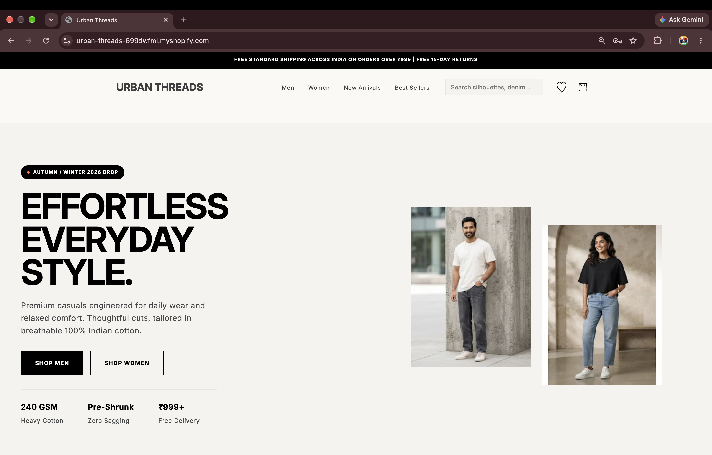 |
| Men collection | 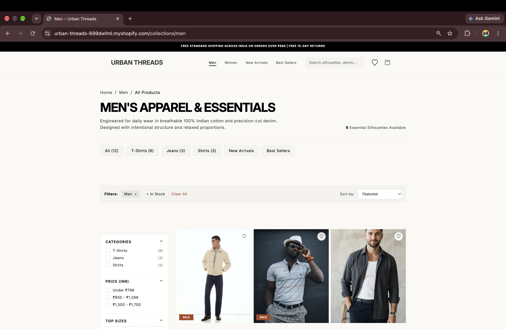 |
| Product page (variant pills, SKU, price) | 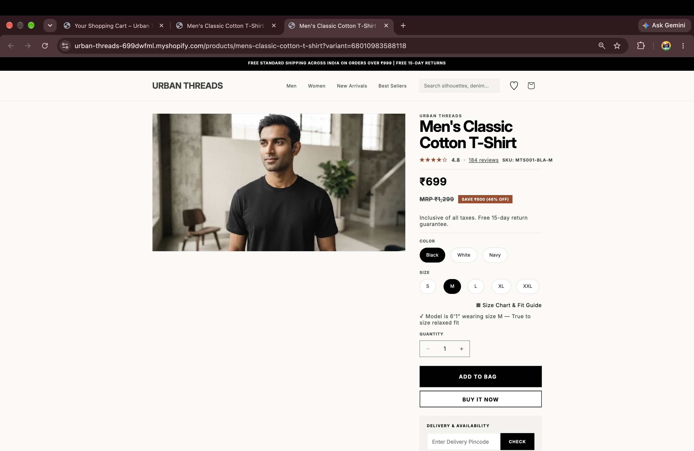 |
| Cart | 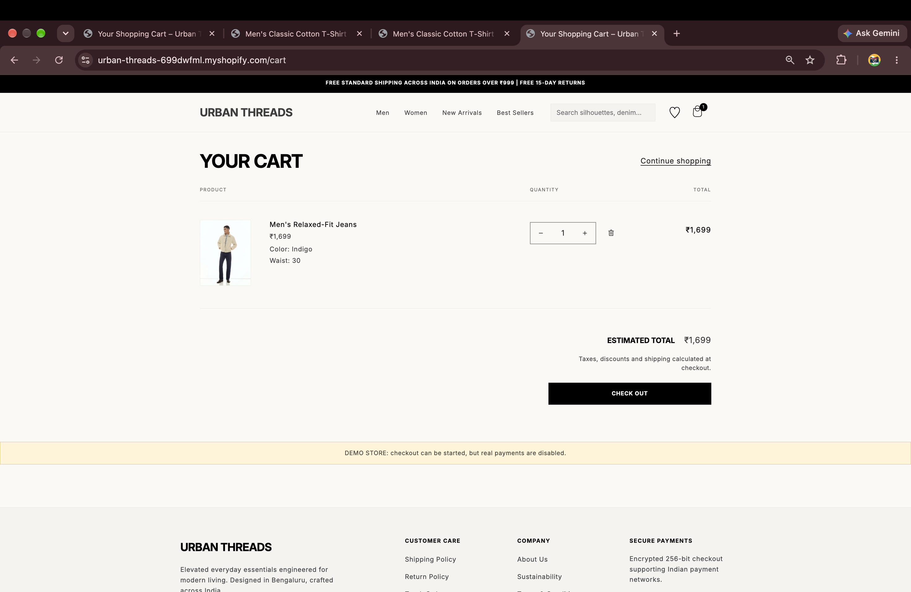 |
| Checkout (stopped before payment; the store cannot accept payments) | 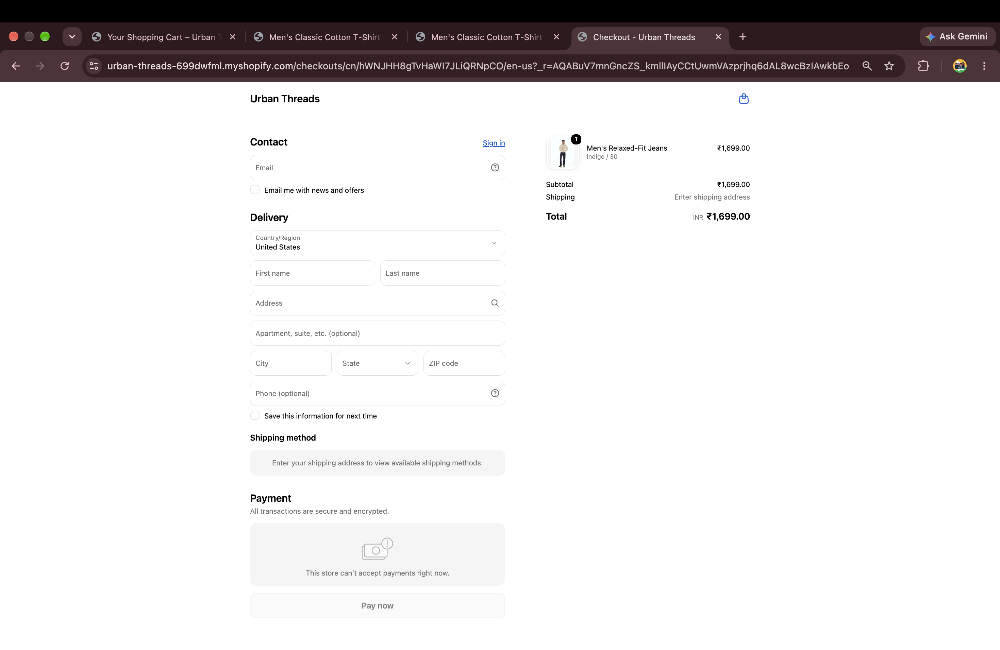 |
| About Us | 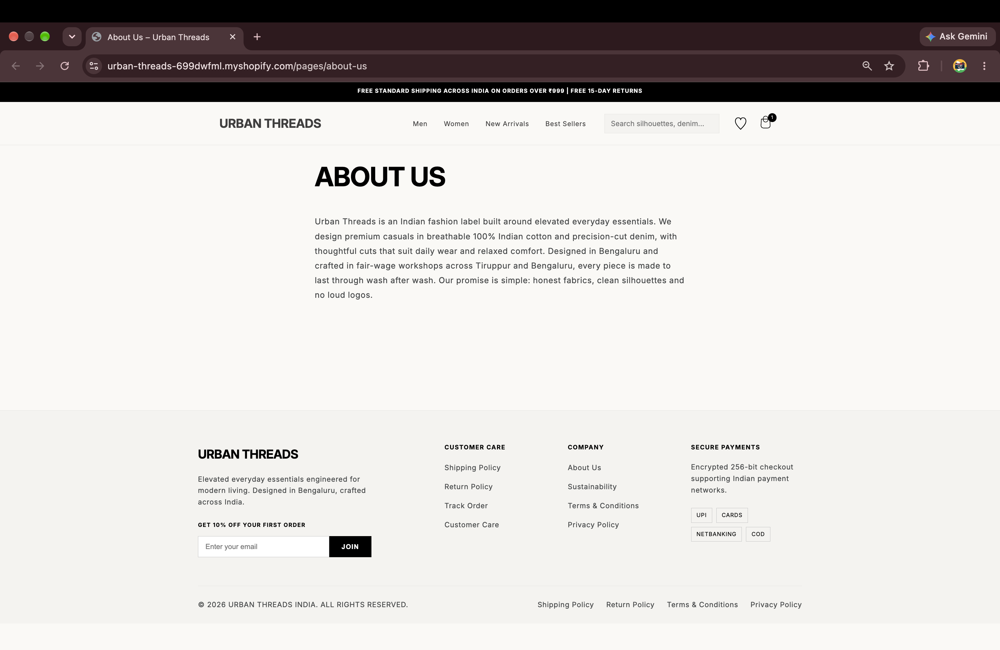 |
| Contact Us |  |
| Shipping Policy | 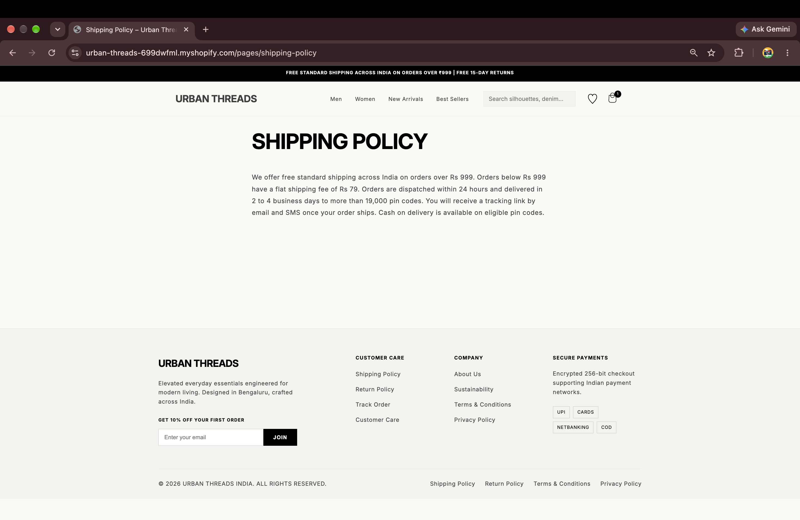 |
| Return Policy |  |

### Storefront (mobile, 375px)

| Page | Screenshot |
|---|---|
| Home | 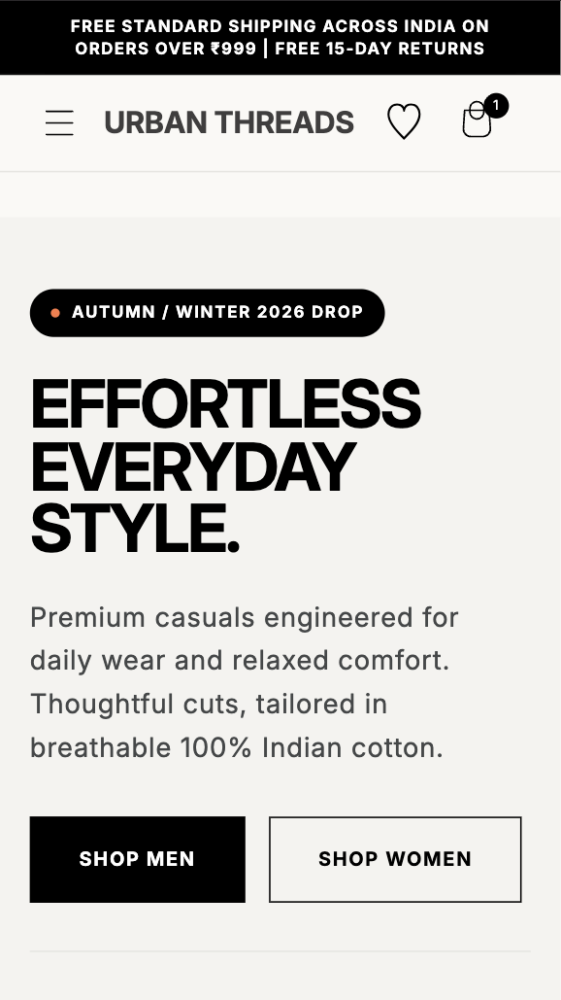 |
| Men collection | 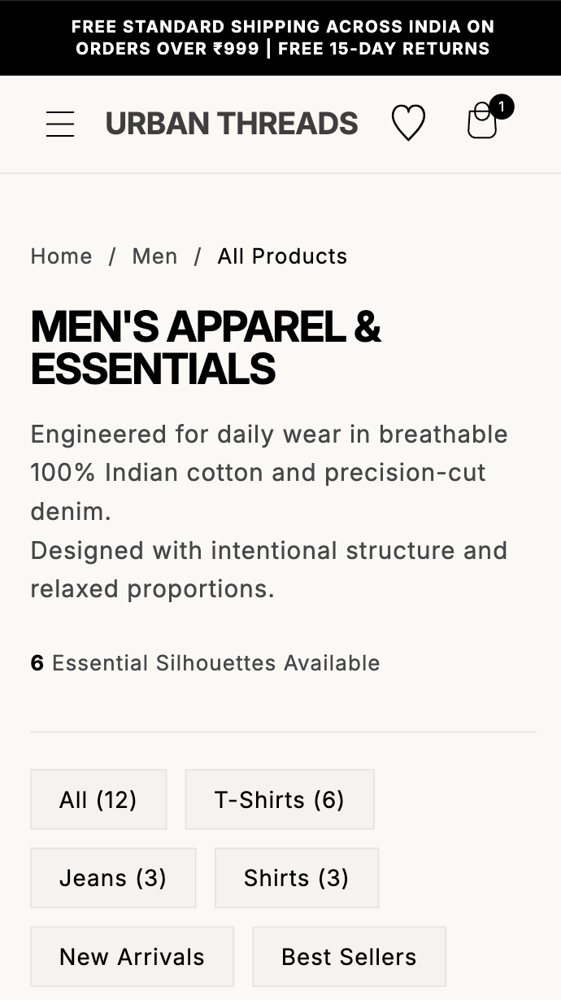 |
| Product page | 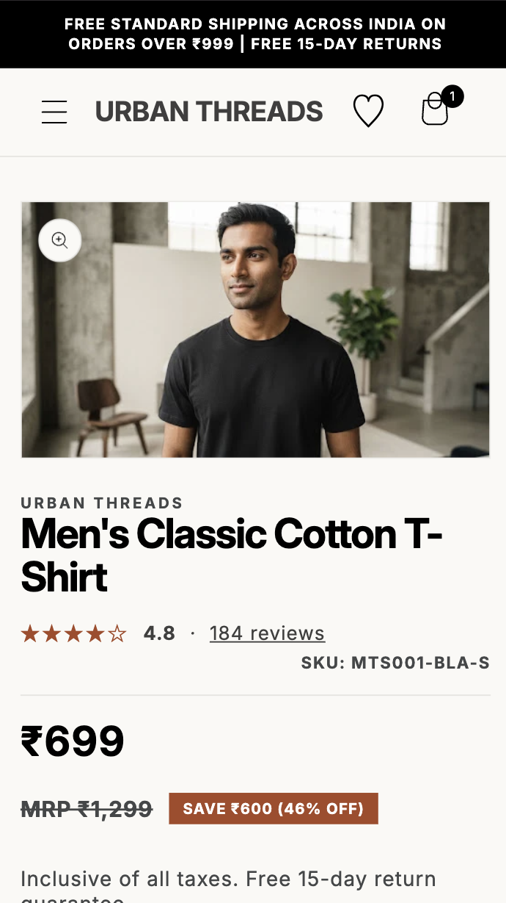 |

### Shopify admin

| Screen | Screenshot |
|---|---|
| Products list (12 products) | 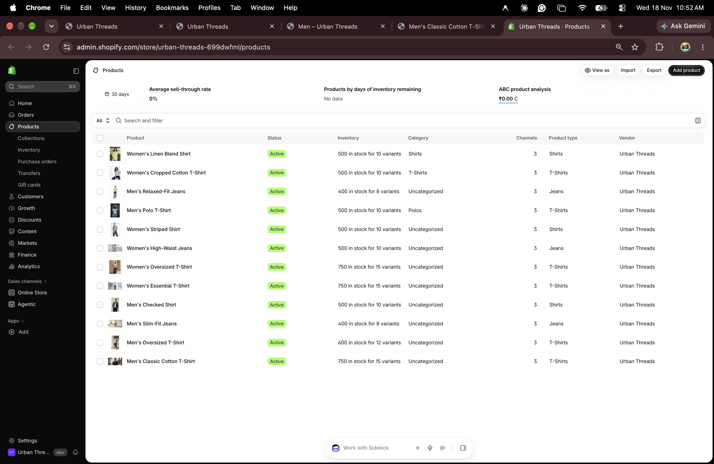 |
| Variants of Men's Classic Cotton T-Shirt (3 colours × 5 sizes) | 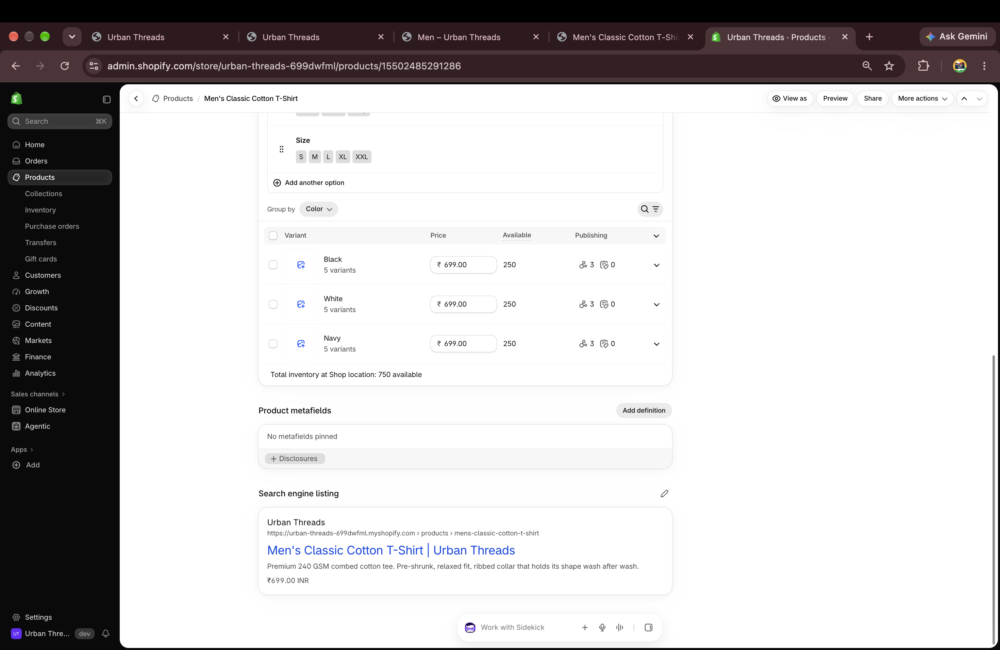 |
| Collections (smart collections with rules) | 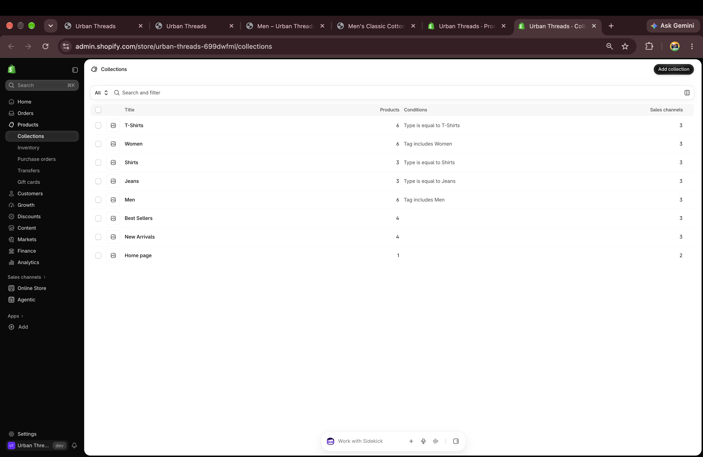 |

## Technical notes

- **Theme:** Dawn is built on Online Store 2.0. Each page is a JSON template made of sections. I customised sections with Custom Liquid (Liquid, HTML, CSS and JavaScript) and theme settings.
- **Variants:** a product can have up to three options, and Shopify builds one variant for every combination. Each variant has its own SKU, price and inventory. For example, the Classic T-Shirt has 3 colours × 5 sizes = 15 variants.
- **Collections:** smart collections use rules such as "tag is Men". Products that match are added automatically, so newly imported products land in the right collection.
- **Cart flow:** the product form posts the chosen variant ID to `/cart/add`, the cart badge updates, and checkout is hosted by Shopify.
- **Why Custom Liquid:** it was the fastest way to match the supplied designs. The trade-off is that these sections are harder to edit in the theme editor.
